<p align="center">
  
</p>

# bsl-speedrun.kz

Тренажёр по языку 1С (BSL): практика с автопроверкой, песочница на OneScript, тесты по теории, база знаний по платформе и БСП.

## Как это выглядит

**Главная.** Все разделы, прогресс и мини-плеер lo-fi радио. Тема переключается в шапке: светлая и тёмная.

| Светлая тема | Тёмная тема |
|---|---|
| 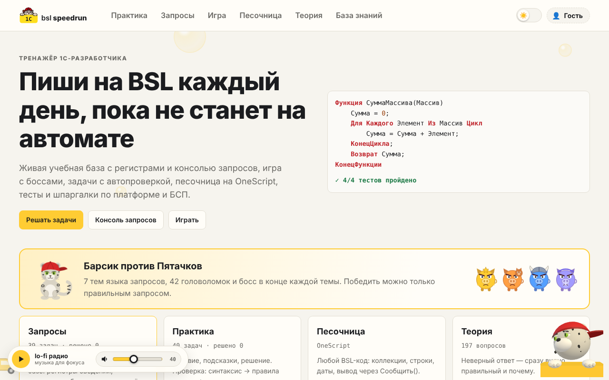 | 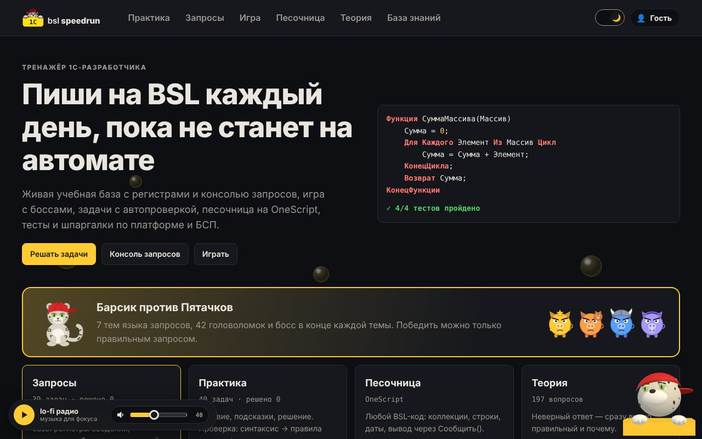 |

**Консоль запросов.** Слева дерево метаданных учебной базы «Барсик-Трейд», справа текст запроса и результат в виде табличного документа. У пакета — вкладка на каждый запрос: видно, что лежит во временной таблице.

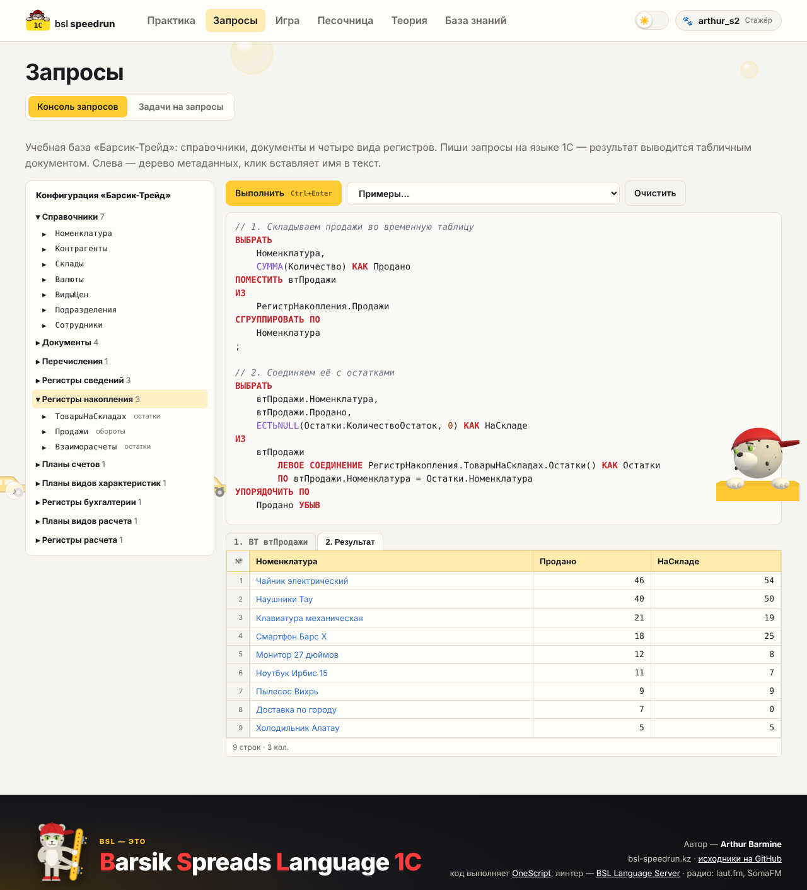

**Задачи на запросы.** Ответ сравнивается с эталоном по результату, а не по тексту. Если не сошлось — можно открыть ожидаемый результат. На скриншоте классическая ловушка: условие на правую таблицу левого соединения стоит в `ГДЕ`.

| Список задач | Задача с проверкой |
|---|---|
| 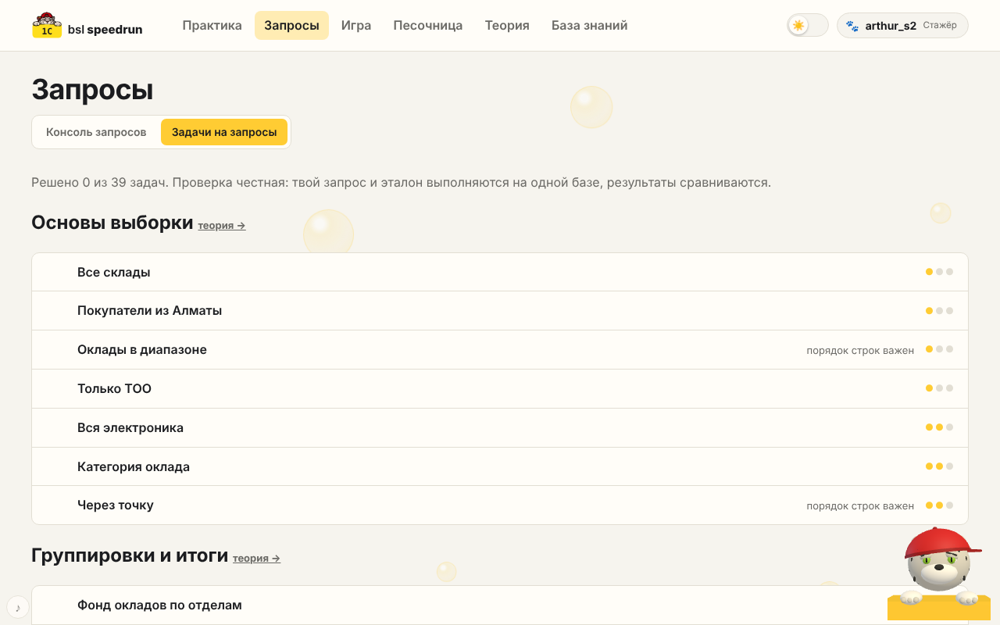 | 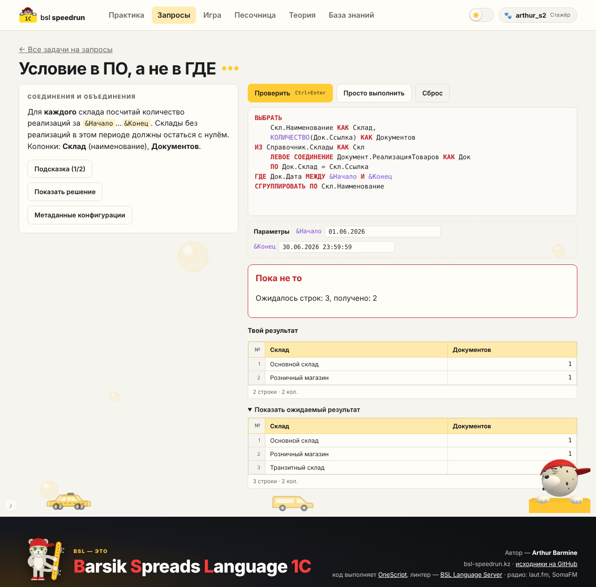 |

**Игра «Барсик против Пятачков».** Семь тем языка запросов. В каждой — головоломки (собрать, заполнить, прочитать, написать, починить запрос) и босс: три раунда, три жизни, неверный запрос — хряк бьёт в ответ.

| Карта тем | Уровень | Босс |
|---|---|---|
| 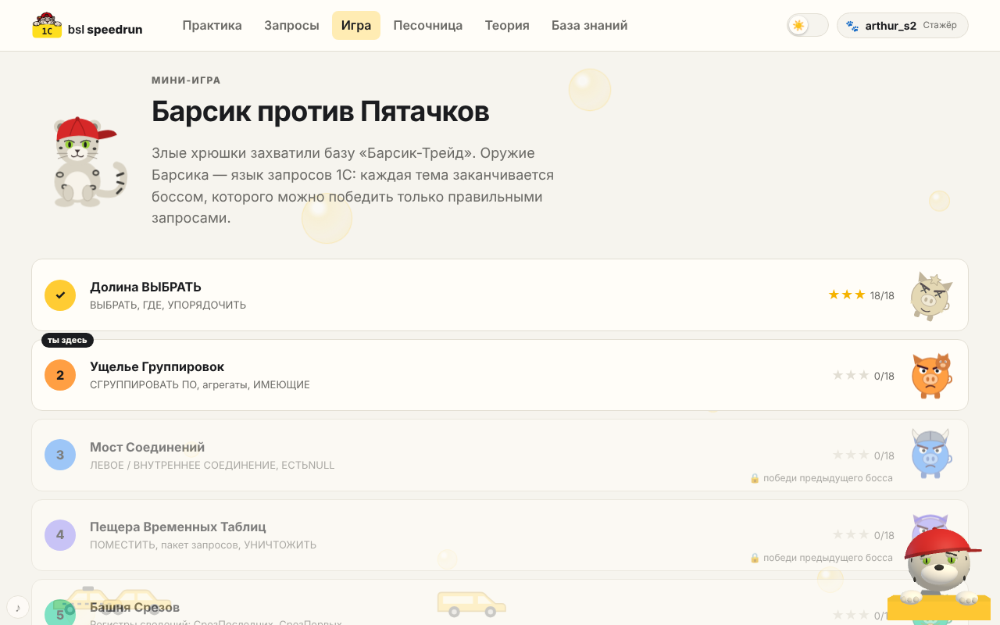 | 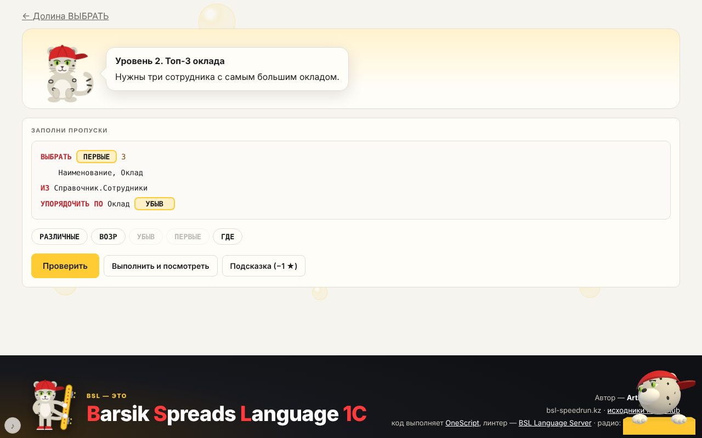 | 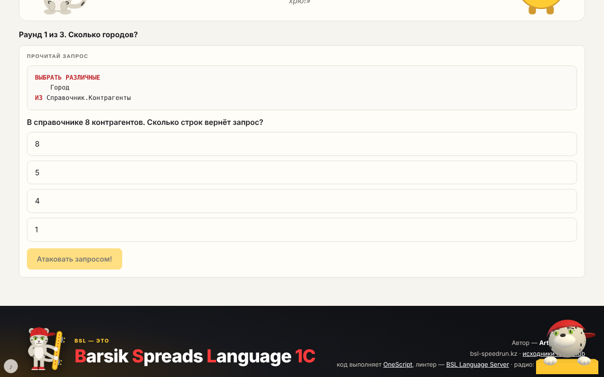 |

**Профиль.** Звание и опыт, прогресс по разделам, значки пройденных тем и достижения. Гостю при входе честно сказано, чего он лишается.

| Профиль | Гостевой вход |
|---|---|
| 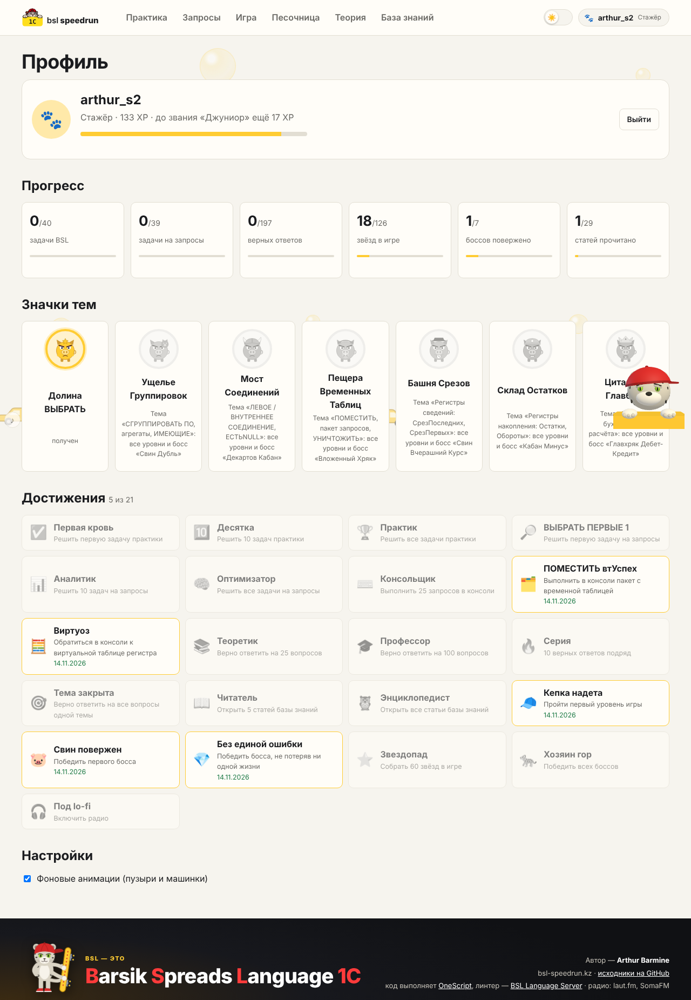 | 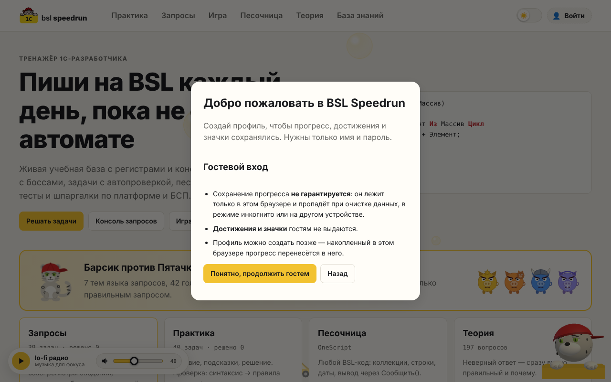 |

**Теория и база знаний.** Вопросы «прочитай запрос и предскажи результат» с объяснением; статьи с примерами, которые можно выполнить в консоли.

| Теория | База знаний |
|---|---|
| 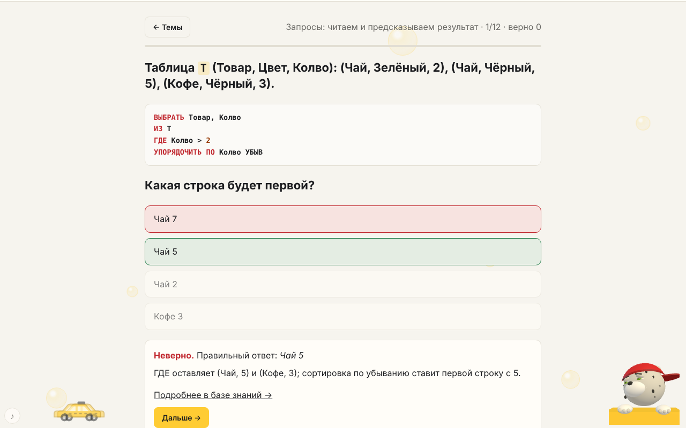 | 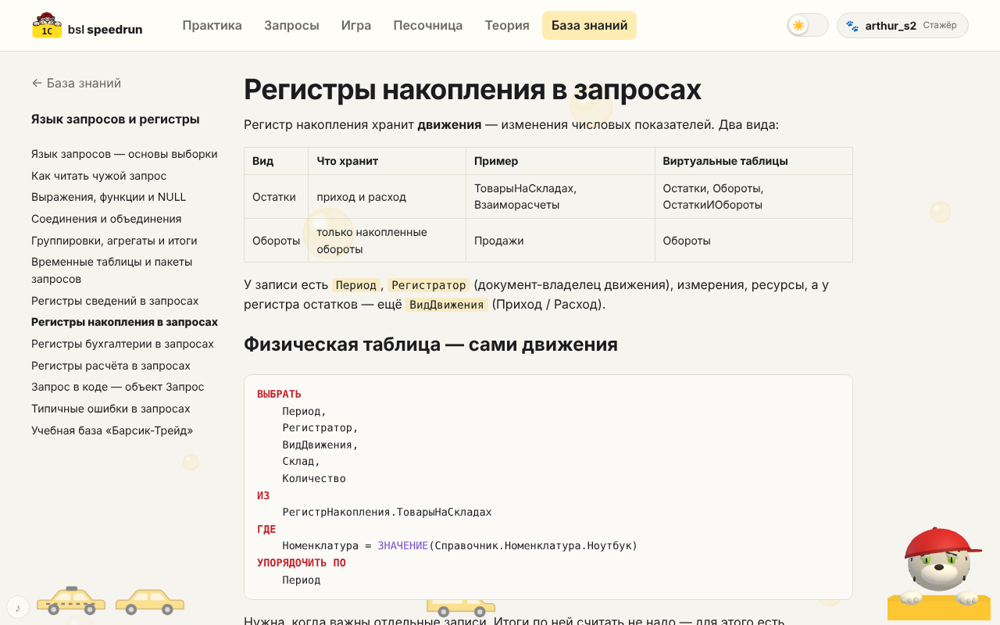 |

**Мелочи.** На внутренних страницах плеер спрятан и выезжает при наведении на левый нижний угол. В подвале — наша расшифровка BSL и Барсик со скейтом. В правом углу живёт 3D-помощник с подсказками по текущей странице.

| Тёмная тема и плеер | Подвал |
|---|---|
| 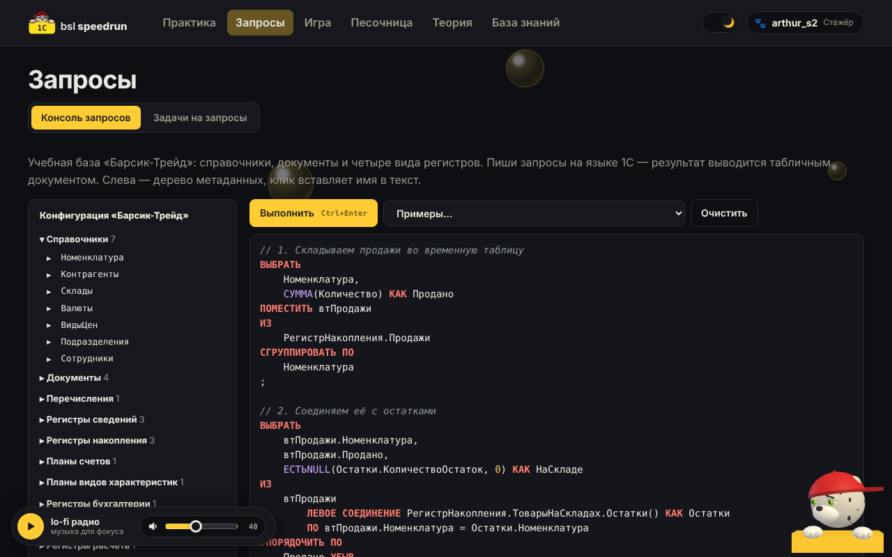 | 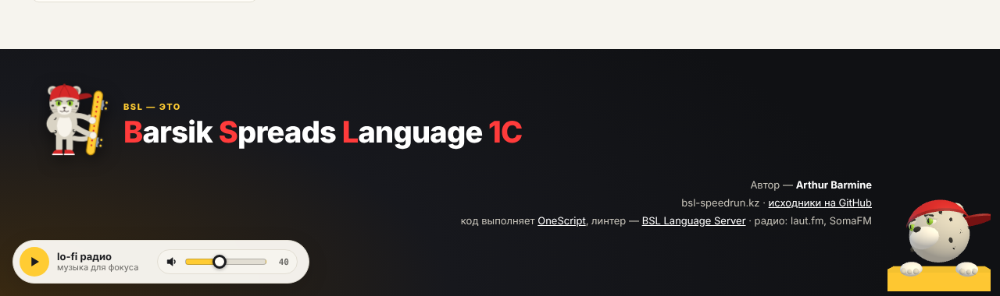 |

## Что внутри

| Раздел | Что умеет |
|---|---|
| **Запросы** | консоль запросов 1С к учебной базе «Барсик-Трейд» (справочники, документы, регистры сведений, накопления, бухгалтерии, расчёта); результат — табличным документом, для пакета — вкладка на каждый запрос, включая содержимое временных таблиц; 39 задач с автопроверкой |
| **Игра** | «Барсик против Пятачков»: 7 тем языка запросов, 42 головоломки (собрать, заполнить, прочитать, написать, починить запрос), в конце каждой темы — босс |
| **Практика** | 40 задач BSL с условием, подсказками и эталоном; проверка: запрещённые вызовы → синтаксис (`oscript -check`) → правила задачи → тесты |
| **Песочница** | любой BSL-код на OneScript: коллекции, строки, даты, `Сообщить()`; без файлов, сети и системных команд, лимит 5 с |
| **Теория** | 197 вопросов по 21 теме; при неверном ответе — правильный и объяснение |
| **База знаний** | 29 статей: язык запросов и регистры, платформа и язык, БСП |
| **Профиль** | аккаунт по имени и паролю, синхронизация прогресса, звания, 21 достижение, значки тем; гостевой режим |
| **Редактор** | Monaco + BSL Language Server: ошибки и замечания линтера, автодополнение, подсказки по методам, форматирование |
| **Атмосфера** | светлая и тёмная тема, мини-плеер lo-fi радио, фоновые анимации, 3D-помощник Барсик с контекстными подсказками |

**Стек:** React + Vite + Monaco + three.js · Node.js (Fastify) · OneScript 2.2 · BSL Language Server 1.0.7 · Caddy · Docker Compose.

## Движок запросов

Запросы выполняются **в браузере** — сервер для них не нужен. `web/src/lib/q1c/`:

| Файл | Назначение |
|---|---|
| `db.js` | виртуальная конфигурация: метаданные и демо-данные; документы «проводятся» в регистры при загрузке |
| `engine.js` | лексер, парсер и исполнитель языка запросов; виртуальные таблицы регистров |
| `check.js` | автопроверка: ответ и эталон выполняются на одной базе, результаты сравниваются |

Поддерживается синтаксис и логика запросов (соединения, группировки, `ИТОГИ`, пакеты с `ПОМЕСТИТЬ`/`УНИЧТОЖИТЬ`, `ВЫБОР`, `ВЫРАЗИТЬ`, параметры, `СрезПоследних`, `Остатки`, `Обороты`, `ОстаткиИОбороты`, `ОборотыДтКт`…). Это учебная модель, не копия платформы — список упрощений в статье «Учебная база „Барсик-Трейд“».

Проверка всего контента по запросам (уровни игры, задачи, примеры из статей):

```bash
node scripts/check-queries.mjs
```

## Профили

- `POST /api/auth/register | login | reset | logout`, `GET | PUT /api/progress` — `api/src/auth.js`.
- Пароли — scrypt с солью, сессии — случайные токены (в файле хранится только SHA-256), срок 60 дней.
- Данные лежат в `users.json` в томе `apidata` (`DATA_DIR`).
- **Сброс пароля работает по одному имени профиля, без подтверждения** — так задумано на текущем этапе. Любой, кто знает имя, может задать новый пароль. Выключается `ALLOW_OPEN_RESET=0` в `.env`.
- Гость: прогресс только в `localStorage` браузера, достижения и значки не выдаются; при создании профиля гостевой прогресс переносится.

## Радио

Мини-плеер (`web/src/components/RadioPlayer.jsx`) играет прямой поток интернет-радио: только пауза и громкость. Список станций — массив `STATIONS` в том же файле; если станция недоступна, плеер переходит к следующей. Нужен прямой HTTPS-адрес потока (mp3/aac).

## Запуск (везде одинаково — Docker)

Нужен только Docker (на Windows — Docker Desktop с WSL2).

```bash
cp .env.example .env          # Windows: copy .env.example .env
docker compose up -d --build
```

Сайт: http://localhost. Первая сборка скачивает OneScript и BSL Language Server — 3–5 минут.

| Сервис | Что делает |
|---|---|
| `web` | Caddy: фронтенд, HTTPS, прокси `/api` и `/lsp` |
| `api` | Node.js + OneScript 2.2, профили и прогресс (том `apidata`). **Без сети**, файловая система только для чтения, лимиты памяти/CPU; с Caddy общается через unix-сокет |
| `bsl-ls` | BSL Language Server (websocket): линтер, автодополнение, hover, форматирование |

## Публикация на домене

1. VPS: Ubuntu 22.04+/24.04, **2 vCPU / 4 ГБ RAM** (BSL LS — Java, ~1 ГБ).
2. Установить Docker: `curl -fsSL https://get.docker.com | sh`.
3. У регистратора домена: A-записи `bsl-speedrun.kz` и `www` → IP сервера.
4. На сервере:
   ```bash
   git clone <repo> bsl-speedrun && cd bsl-speedrun
   cp .env.example .env
   # в .env: SITE_ADDRESS=bsl-speedrun.kz, www.bsl-speedrun.kz
   docker compose up -d --build
   ```
   Caddy сам получит сертификат Let's Encrypt (порты 80 и 443 должны быть открыты).
5. Обновление: `git pull && docker compose up -d --build`.

## Разработка без Docker

### Windows (PowerShell)

1. Скачать в папку `tools\` (она в `.gitignore`):
   - [OneScript-2.2.0-win-x64.zip](https://github.com/EvilBeaver/OneScript/releases/tag/v2.2.0) → распаковать в `tools\onescript`;
   - [bsl-language-server_win.zip](https://github.com/1c-syntax/bsl-language-server/releases/tag/v1.0.7) → распаковать в `tools\bsl-ls` (Java внутри, ставить не нужно).
2. Три окна терминала:
   ```powershell
   # 1. API
   cd api; npm.cmd ci
   $env:OSCRIPT_BIN = "$PWD\..\tools\onescript\bin\oscript.exe"; $env:PORT = "8787"; node src/server.js

   # 2. BSL LS
   tools\bsl-ls\bsl-language-server\bsl-language-server.exe websocket --server.port=8025

   # 3. Сайт
   cd web; npm.cmd ci; npm.cmd run dev
   ```
3. Открыть http://127.0.0.1:5173.

### Linux / macOS

```bash
cd api && npm install && OSCRIPT_BIN=путь/к/oscript PORT=8787 npm start
cd web && npm install && npm run dev          # http://localhost:5173
```

В PowerShell вместо `npm` используй `npm.cmd`, если скрипты запрещены политикой. Линтер в dev-режиме ждёт BSL LS на `:8025`:
`java -jar bsl-language-server-exec.jar websocket --server.port=8025`.

## Контент — просто файлы в `content/`

```
content/
  tasks/<id>/        задача практики
    task.md            условие (Markdown)
    meta.yaml          название, сложность, теги, подсказки, тесты, правила
    starter.os         заготовка
    solution.os        эталонное решение
  queries/*.yaml     задачи на запросы: условие, заготовка, эталонный запрос, параметры, правила
  quiz/*.yaml        теория: вопросы, варианты, номер правильного (с 0), объяснение
  kb/queries/*.md    база знаний: язык запросов и регистры (блоки ```query проверяются скриптом)
  kb/general/*.md    база знаний: платформа и язык
  kb/bsp/*.md        база знаний: БСП
  sandbox/*.os       примеры для песочницы (первая строка-комментарий = название)
```

### Тесты задачи (`meta.yaml`)

```yaml
function: СуммаМассива
cases:
  - args: [[1, 2, 3]]        # массив → Массив
    expected: 6
  - args: [{Имя: "Артур"}]   # объект → Структура
    expected: {$map: [["ключ", 1]]}   # → Соответствие
  - args: [{$date: "2026-01-01"}]     # → Дата
    expected: null           # → Неопределено
rules:
  required:  [{pattern: 'Для\s+Каждого', message: Используй цикл «Для Каждого»}]
  forbidden: [{pattern: '\.\s*Найти\s*\(', message: Без Массив.Найти()}]
```

Для задач «на вывод»: `mode: output` и `expectedOutput: |` с ожидаемым текстом.

Проверка: запрещённые вызовы → `oscript -check` → правила задачи → запуск кода ученика с проверочным кодом (`api/runtime/harness.os`).

## Безопасность песочницы

1. Контейнер `api`: `network_mode: none`, read-only FS, tmpfs `/tmp`, `cap_drop: ALL`, лимиты памяти/CPU/процессов.
2. Таймаут 5 с, лимит вывода 64 КБ, не больше 2 запусков параллельно, 30 запусков в минуту с IP.
3. До запуска отсекаются файлы, сеть, процессы, `Выполнить`/`Вычислить`, `#Использовать` (`api/src/guard.js`).

## Материалы speedrunit.ru

`speedrunit/scrape.py` скачивает вопросы в `speedrunit/` (папка в `.gitignore`, только для личного использования). На сайт тексты оттуда не копируются: по их темам написаны свои вопросы и статьи.

## Автор

Arthur Barmine.
